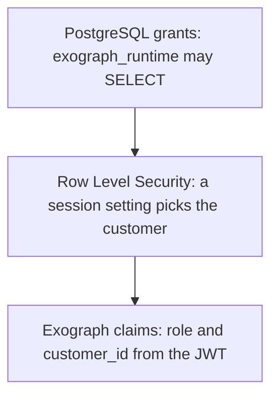

# Module 3 — Authorization and Data Boundaries

*Exograph with PostgreSQL: Semantic Modeling & MCP · Goliath Research Academy*

[Course plan](../README.md) · [Module 2](../2%20-%20Import%20and%20Refine%20the%20Exograph%20Model/02_content.md)

> Includes the runnable Exograph model ([src/index.exo](src/index.exo) and [src/staff_report.ts](src/staff_report.ts)), identity template ([identity.env.example](identity.env.example)), and automated acceptance suites ([tests/test_access.py](tests/test_access.py) and [tests/test_remaining_access.py](tests/test_remaining_access.py)).

## Goal

Keep each customer's orders private while allowing staff to read approved sales aggregates. The PostgreSQL runtime role can read both customers' fixture rows but cannot write them. Exograph must enforce caller-specific access; Module 4 will separately control MCP tool exposure.

## Define the policy

| Caller | Order history | Staff reporting |
| --- | --- | --- |
| Anonymous or invalid identity | Denied | Denied |
| Ada, customer 1 | Order 101 and its lines only | Denied |
| Lin, customer 2 | Order 102 and its lines only | Denied |
| Authenticated staff | No blanket customer-history access | Approved sales aggregates only |

Derive customer identity and staff privileges from verified claims, never from tool arguments or unverified headers. Use local test identities and keep signing material out of version control. An order ID identifies a requested row; it does not prove ownership.

## Apply the policy to every exposed path

- Apply ownership rules to direct order reads, lists, and filters.
- Derive order-line ownership from the parent order. Enforce it on direct line reads and nested selections.
- Review reverse relationships such as customer-to-orders and product-to-order-lines. Remove unused paths and apply the same rules to any that remain.
- Keep staff reporting separate from customer history. Do not return customer names or unrelated order details.

## Verify against the synthetic fixture

Run these checks on Exograph's query interface before enabling MCP. A denial may be an error, a missing row, or an empty list; document the expected behavior and check that no protected data appears. A malformed request or unavailable service does not count as a denial.

| Check | Expected result |
| --- | --- |
| Ada reads order 101; Lin reads order 102 | Ada sees two lines totaling 3,200 cents; Lin sees one line totaling 1,200 cents. |
| Each customer reads the other's order or lists orders without an ownership filter | Cross-customer lookups reveal nothing; lists contain only the caller's order. |
| Ada requests line 1003 directly or through the BOOK-01 reverse relationship | Lin's line is not returned. If a path is intentionally removed, verify that it is unavailable. |
| Anonymous caller or invalid token requests history | No protected data is returned. |
| A customer requests the staff report | Denied. |
| Staff requests January 2026 sales for PAID and SHIPPED orders | Books: 3,600 cents; Games: 800 cents; no customer names. |

## PostgreSQL row-level security, beside the model

PostgreSQL can also hide rows. The companion [rls_comparison.sql](rls_comparison.sql) runs as the setup role, enables row-level security on `commerce.orders`, and adds one policy:

```sql
USING (customer_id = current_setting('app.customer_id')::integer)
```

The setup role is the database superuser, so the script switches to `exograph_runtime` for the filtered reads. With `app.customer_id` set to `1`, that role sees order 101. Set to `2`, it sees order 102. The script then rolls the transaction back. The Exograph runtime role keeps the `SELECT` grant from Module 1, and this policy is not left in place.



The three controls answer different questions. A grant decides whether a login may read the table. A policy decides which rows that login's session may see. An Exograph `@access` rule decides which rows a caller may see from a verified claim. Students implement the Exograph rules. The SQL policy is the comparison.

`OrderItem` access follows the parent order: `self.order.customer.customerId` must equal `AuthContext.customerId`. It does not list fixture order ids. `internal_staff_report` is a context the staff-report module injects when it runs its privileged query. It is not a JWT role. A staff token carries `role=staff`, which authorizes `staffSalesReport` and does not grant blanket customer history.

## Evidence and handoff

Submit the access matrix, model rules and verified claims they use, and a pass/fail record that includes direct and nested isolation checks. Omit tokens and connection strings. List the read-only operations eligible for Module 4 MCP exposure. Both customer self-reads must succeed, cross-customer reads must fail on every exposed path, and staff reporting must return only approved data.
